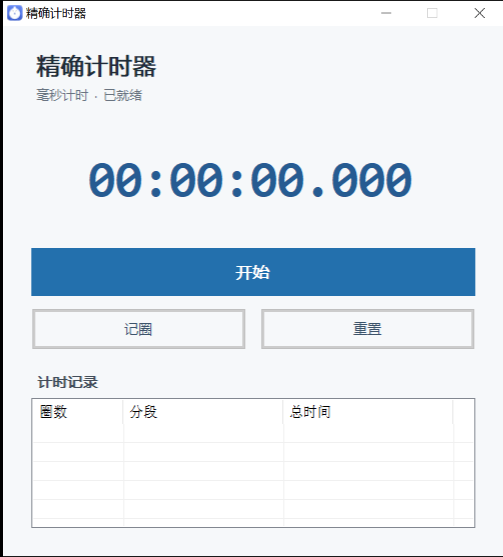

# 精确计时器 PreciseTimer

[](https://github.com/ZTOLH/precise-timer/actions/workflows/build.yml)
[](LICENSE)
[](#兼容性)
[](#从源码构建)

一个**单文件、免安装、零依赖**的 Windows 毫秒计时器。11 KB 的 exe，双击即用，不需要 .NET SDK、不需要 Electron、不需要 WebView2，只用到系统自带的 .NET Framework 4.x。



## 功能

- **毫秒级显示**：时间格式 `HH:MM:SS.mmm`，用 `Stopwatch`（Windows 高精度计数器）计时，显示每 8 ms 刷新一次。
- **开始 / 暂停 / 继续**：暂停后再次点击继续，已累计的时间不会丢失。
- **记圈**：滚动到毫秒即可记圈，同时显示**分段耗时**与**累计总时间**，最新一圈在最上方。
- **重置**：暂停状态下可重置，清空当前计时与全部记圈。
- **自动保存**：操作时和关闭窗口时都会写入 `timer-data.json`，下次打开自动恢复（恢复为暂停状态，关闭期间不计时）。

## 快速开始

### 直接用（推荐）

1. 到 [Releases](https://github.com/ZTOLH/precise-timer/releases) 下载 `PreciseTimer.exe`；
2. 双击运行。

程序是绿色单文件，想放哪放哪；计时记录存在 exe 所在目录的 `timer-data.json` 里。如果放到 `C:\Program Files` 这类没有写权限的目录，就无法保存记录，建议放在桌面或自己的文件夹。

### 从源码构建

只需要 Windows 自带的 C# 编译器（.NET Framework 4.x 组件），无需安装任何 SDK：

```powershell
git clone https://github.com/ZTOLH/precise-timer.git
cd precise-timer
powershell -ExecutionPolicy Bypass -File .\build.ps1
```

产物是当前目录下的 `PreciseTimer.exe`。构建脚本实际只做一件事：

```
csc.exe /target:winexe /optimize+ /win32icon:src\timer.ico
        /out:PreciseTimer.exe
        /reference:System.dll,System.Drawing.dll,System.Windows.Forms.dll,System.Web.Extensions.dll
        src\TimerApp.cs
```

推送 `v*` 形式的标签时，GitHub Actions 会自动编译并把 exe 挂到 Release 上。

## 精度说明

- **计时源**是 `System.Diagnostics.Stopwatch`，背后是 QueryPerformanceCounter，分辨率通常在微秒级，长时间跑也不会累积漂移；
- **刷新频率**是 8 ms（约 120 帧/秒），用 `System.Windows.Forms.Timer` 驱动重绘。屏幕上看不到 1 ms 的跳动是正常的——显示刷新率与计时精度是两件事，暂停/记圈时取的值仍然是高精度计数器的真实值；
- 界面关闭期间不计时：重新打开时恢复上次的累计时间并处于暂停状态，避免"关掉程序还在偷偷走表"。

## 数据格式

`timer-data.json` 与 exe 同目录，写入时先写 `.tmp` 再原子替换，避免中途断电把文件写坏：

```json
{
  "elapsedMilliseconds": 12345,
  "laps": [12345, 8000]
}
```

`laps` 里存的是每一圈的**累计耗时**（毫秒），最新的在前。

## 项目结构

```
.
├── src/
│   ├── TimerApp.cs      # 全部界面与逻辑，单文件 WinForms
│   └── timer.ico        # 应用图标
├── docs/screenshot.png  # 截图
├── build.ps1            # 调用 csc.exe 编译
├── validate.ps1         # 反射驱动窗口做行为验证（8 项断言）
└── .github/workflows/build.yml
```

## 验证

`validate.ps1` 不靠人眼看，而是反射加载编译好的 exe，直接调用窗口内部方法并断言行为：

```powershell
powershell -ExecutionPolicy Bypass -File .\validate.ps1
```

覆盖：计时推进、暂停不推进、继续后累加、记圈顺序、重开恢复、重置清空、exe 是否带图标。全部通过时输出 `ALL_CHECKS_PASSED`。

## 兼容性

Windows 10 / 11，需要 .NET Framework 4.x（Win10 1803 以后是系统自带组件，无需另外安装）。32/64 位 Windows 都能跑。

## 许可证

[MIT](LICENSE) © ZTOLH
